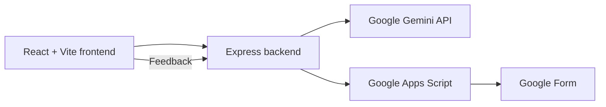

# CodeJourney AI

<p align="center">
  
</p>

Understand code by following its execution, one step at a time.

CodeJourney AI turns a code snippet into a plain-language execution flow. Follow
each step, see the related source lines, listen to the explanation, and ask
questions about the code.

## What it does

- Generates an execution flow with decisions, actions, and code-line mappings.
- Highlights the source lines associated with each flow step.
- Reads explanations aloud and supports playback controls.
- Formats code and answers questions about a selected line.
- Accepts code pasted into the editor or uploaded from a file.
- Collects optional star ratings and feedback, with a site-wide thank-you shown
  only after Google Forms confirms the response was saved.

Languages currently available: JavaScript, TypeScript, Python, Java, C, C++,
C#, Go, Rust, PHP, Apex, and Apex Trigger.

## How it works



The frontend is in `CodeExplainr/`; the TypeScript API is in `backend/`.
Gemini credentials and the Apps Script deployment URL are kept on the backend
and are not bundled into the browser app.

## Requirements

- Node.js 20.19+ or 22.12+
- npm
- A Gemini API key for code explanations, formatting, and Q&A
- Optional: a Google Form and deployed Apps Script web app for feedback

## Run locally

Clone the repository and open its root directory:

```shell
git clone https://github.com/Akash4701/CodeExplainer.git
cd CodeExplainer
```

### 1. Configure and run the backend

```shell
cd backend
npm install
```

Copy `backend/.env.example` to `backend/.env` (PowerShell:
`Copy-Item .env.example .env`; macOS/Linux: `cp .env.example .env`).

Set the following in `backend/.env`:

```dotenv
PORT=3000
GEMINI_API_KEY=your_gemini_api_key
GOOGLE_APPS_SCRIPT_URL=
```

`GOOGLE_APPS_SCRIPT_URL` is optional unless you want to enable Google Forms
feedback. See [Google Forms feedback setup](#google-forms-feedback-setup).

Start the API:

```powershell
npm run dev
```

The backend listens on `http://localhost:3000` by default.

### 2. Configure and run the frontend

In a second terminal, from the repository root:

```shell
cd CodeExplainr
npm install
```

Copy `CodeExplainr/.env.example` to `CodeExplainr/.env` (PowerShell:
`Copy-Item .env.example .env`; macOS/Linux: `cp .env.example .env`).

Set `VITE_API_URL` in `CodeExplainr/.env` to the backend origin:

```dotenv
VITE_API_URL=http://localhost:3000
```

Start Vite:

```shell
npm run dev
```

Open the local URL printed by Vite (usually `http://localhost:5173`).
Restart the relevant development server after changing its `.env` file.

## Google Forms feedback setup

The feedback form submits through the backend to Google Apps Script. The
celebration is shown only when the script confirms that it submitted the
response to the Google Form.

1. Create a Google Form with a required 1–5 rating question and a required
   paragraph-text feedback question. Disable email collection and remove any
   other required questions; the site does not ask visitors for their email.
2. Create an Apps Script project and paste in
   [`backend/google-apps-script/Code.gs`](backend/google-apps-script/Code.gs).
3. In **Project Settings → Script Properties**, add:
   - `FORM_ID`: the ID from the form's edit URL.
   - `RATING_ITEM_ID`: the numeric ID of the rating question.
   - `FEEDBACK_ITEM_ID`: the numeric ID of the feedback question.
4. Run `listFeedbackFormItems` from the Apps Script editor to log the form's
   question IDs and types. Copy the IDs for the rating and feedback questions
   into the matching Script Properties.
5. Deploy the script as a **Web app**, set it to execute as you, and allow
   access to anyone. Copy the deployment URL ending in `/exec` into
   `GOOGLE_APPS_SCRIPT_URL` in `backend/.env`.
6. Restart the backend. After changing Apps Script code, deploy a **new
   version** so the live endpoint uses the updated script.

The Apps Script URL belongs in the backend environment only. Do not put it in a
`VITE_` variable. Feedback errors appear in the form; the backend logs the
specific Apps Script failure for troubleshooting.

## API endpoints

| Method | Endpoint | Purpose |
| --- | --- | --- |
| `POST` | `/api/v1/explain` | Generate an execution-flow explanation |
| `POST` | `/api/v1/format-code` | Format a code snippet |
| `POST` | `/api/v1/answer-question` | Answer a question about a selected line |
| `POST` | `/api/v1/feedback` | Save rating and feedback through Apps Script |

## Development commands

Run these from `CodeExplainr/`:

```shell
npm run lint
npm run build
npm run preview
```

Run these from `backend/`:

```shell
npm run build
npm run dev
```

## Project layout

```text
CodeExplainr/
  src/
    Components/       Editor, playback, feedback, and UI components
    pages/            Main page, navigation, and footer
    config/           API endpoints and supported languages
    types/            Execution-flow types and helpers
  public/             Static assets
backend/
  components/         Gemini prompts and response processing
  src/controller/     API request handlers
  src/router/         Express routes
  src/utils/          Shared backend utilities
  google-apps-script/ Google Form submission handler
```

## Privacy and configuration

- Never commit `.env` files or API keys.
- `VITE_` variables are included in the frontend bundle; use them only for
  public configuration such as the API origin.
- Code snippets and questions are sent to the backend and then to Gemini to
  generate the requested response. Do not submit code containing secrets or
  personal data.
- Feedback is submitted to the Google Form configured by the project owner.

## Troubleshooting

- **Frontend says `VITE_API_URL` is not configured:** create
  `CodeExplainr/.env`, set the backend origin, and restart Vite.
- **AI requests fail:** verify `GEMINI_API_KEY` in `backend/.env` and restart
  the backend. A `429` means the model is rate-limited or temporarily busy;
  wait before retrying.
- **Feedback cannot be saved:** confirm the Apps Script deployment URL and
  Script Properties, ensure the form accepts responses and has no required
  email field, and deploy a new script version after edits. Check the backend
  log for the Apps Script error.
